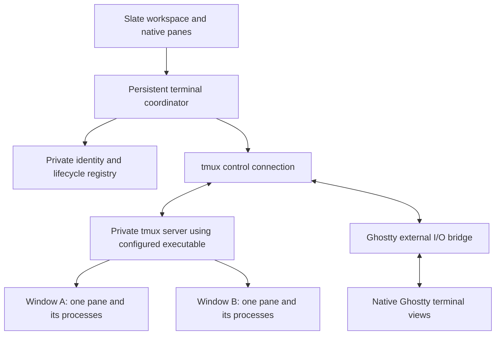

# Native tmux persistence for Slate

Status: deferred — future work. Source research and independent plan review are complete; implementation and runtime qualification have not started.

Current priority (2026-10-20, clarified): a solid terminal with application-independent process shutdown and bounded saved output, retaining existing working-directory restoration. Do not add last-command restoration, command replay, per-application adapters, conversation-ID tracking or per-pane resume actions. Shell command history remains the shell's responsibility; intentionally detached application daemons retain their own lifecycle. The design below is retained for a future process-persistence increment and is not the current implementation scope.

The immediate shutdown direction is to request termination while the terminal can still receive output, run bounded stop attempts concurrently, preserve received final output, then dispose of the terminal. Capture before shutdown as well, since a TUI may clear its alternate screen on exit. The current implementation and selected VM evidence are recorded in [terminal recovery](terminal-recovery-implementation.md); merely sleeping after disposal cannot recover output. Application-specific exit messages remain best effort: generic terminal signals do not guarantee the same behavior as an application's own Quit command. A surviving detached daemon is not, by itself, evidence that terminal-owned process cleanup failed.

## Outcome and scope

An opted-in terminal keeps its shell and programs running when Slate quits or crashes. Reopening Slate reconnects the same terminal to its native pane, with restored history, screen and input modes. Selection, scrolling, search, splits and mixed browser/plugin layouts remain Slate interactions. Users provide tmux and select its executable in Settings; Slate neither bundles nor installs it.

Restoration covers the supported tmux terminal capabilities, with ordinary TUI text and input as the initial baseline. Applications still run inside tmux and see its terminal environment. Native rendering does not remove tmux's capability limits: graphics, hyperlinks and semantic OSC state need explicit qualification, especially across reconnects.

Build **control mode directly**. Ordinary hidden tmux clients, automatic foreground-command replay, remote SSH transport, importing arbitrary tmux workspaces, tmux layout mirroring, multiple simultaneous GUI owners and a Slate-owned process daemon are outside this increment. Reboot and tmux-server failure end process continuity. Missing sessions produce a recovery state, never an automatic replay of the last command.

## Architecture



Use one private server and one managed tmux session per Slate state-directory identity. Each persistent terminal is one tmux window with exactly one tmux pane. One programmatic control connection can receive all their output. Slate's workspace already spans native windows and tabs: moving a pane between them does not change its backend ownership.

Set managed windows to manual sizing; target each window explicitly on resize. Slate supplies desired cell dimensions, tmux supplies confirmed backend dimensions, and the rendered terminal reconciles to those dimensions. Coalesce resizing and reject obsolete replies. No shared client-size policy may force sibling panes to the same dimensions.

The engine seam must separate requested geometry from confirmed geometry. Ghostty currently resizes its terminal immediately after calling the backend; an asynchronous tmux resize needs explicit ordering before inheriting that behavior.

Separate four identities: Slate pane slot, durable terminal UUID, tmux server generation plus object IDs, and the current GUI attachment generation. Store the durable UUID and owner identity as tmux metadata. Never restore or kill by a window index, title, PID or reused `%pane` ID alone. Preserve the UUID when moving a pane; allocate another when replacing its terminal.

Use a private socket and controlled configuration, independent of the user's default server and `~/.tmux.conf`. A user-provided binary does not imply user-provided backend configuration. Establish options before starting user shells, including lifecycle, history limits, terminal capabilities and explicit environment policy. Unexpected objects or altered topology produce an unsupported-state diagnostic; do not import or destroy them automatically.

## Ghostty integration and reuse

Prefer a narrow **external I/O backend beside Ghostty's existing Exec backend**, with a C bridge used by Swift. Keep Ghostty responsible for rendering, selection, search, IME and encoding user input. The bridge must support:

- Creating a renderable terminal without launching a child shell.
- Copying bounded incoming bytes onto the terminal's owned I/O path.
- Emitting encoded user input and desired geometry with explicit callback lifetimes.
- Applying a validated history/screen/mode snapshot to the actual rendered terminal under its existing synchronization.
- Detaching and disposing the view without terminating tmux processes.

Distinguish **user input from terminal-generated replies** before they enter Ghostty's shared write queue. tmux answers ordinary terminal queries; forwarding Ghostty's duplicate replies into the application is incorrect. Define response ownership per supported query, including separately routed exceptions such as color queries, and clipboard/passthrough behavior. Historical restoration must not repeat notifications, clipboard writes or other past terminal side effects.

Slate launches the configured executable in control mode using argument arrays and pipes. Use `-C` for that direct transport; `-CC`'s terminal-mode setup and DCS framing are useful for terminal-hosted entry, not a reason to introduce an extra PTY here. Frame commands with LF, parse payloads as bytes, and inject Ghostty-encoded bytes through bounded, pane-targeted literal-byte commands. Encode once; do not pass those bytes through a second named-key encoder.

Reuse Ghostty's parser/format/state helpers only after testing and hardening them. Its Viewer is a reference for reconstruction, not the authoritative controller: it owns separate terminal models and has incomplete startup handling. Extract/adapt restoration operations to the surface-owned terminal; do not keep an independently diverging Viewer terminal beside each rendered terminal. A PTY adapter remains a disposable feasibility alternative if the engine seam proves unsuitable, not the planned shipping architecture.

Maintain the engine change as a pinned, reviewable patch through the existing Ghostty bootstrap and patch verification. This plan does not authorize an upstream publication or a broad engine upgrade.

## Restoration is a transaction at the display boundary

Each attachment progresses through `disconnected → connecting → synchronizing → ready`, with explicit `missing`, `incompatible` and `failed` states. A disconnection is not a process exit. Accept input only after the correct attachment is ready; discard queued input across a connection-generation change.

On reconnect:

1. Check the executable and connected server capabilities, owner metadata and server generation.
2. Enumerate managed objects and match durable terminal IDs; reconcile incomplete creation/closure records.
3. Set each window's intended geometry using explicit targets.
4. Obtain bounded primary history, primary and alternate screens, cursor/saved cursor, scroll region, tab stops, mouse/focus modes, bracketed paste and supported keyboard modes. Capture any partially parsed pending terminal bytes as well.
5. Install the snapshot and join live output at a defined protocol boundary. Use tmux's supported output control and serialized command ordering; prove the boundary with continuously changing output. Buffering all events and replaying them after a snapshot can duplicate output; ignoring them arbitrarily can lose output.
6. Reconcile Slate shell integration, publish ready state, then enable input.

Bound protocol lines, replies, history, live queues and per-pane work. Support extended-output/pause notifications and controlled resynchronization when behind. A noisy pane must not block input to other panes or grow memory indefinitely. Never silently drop bytes and keep claiming a synchronized display.

The first milestone must demonstrate the snapshot/live transition, including incomplete escape sequences and resize races. That algorithm remains to be implemented and proven; source inspection is not evidence that it already works in Slate.

## Settings and lifecycle

Proposed settings, subject to final naming in the existing configuration model:

```toml
[terminal]
process_persistence = "off" # off or tmux; applies to new terminals
tmux_executable = "/opt/homebrew/bin/tmux"
```

Settings provides an executable chooser and connection/compatibility status. An optional discovery action checks ordinary executable locations; it does not run a login shell or evaluate arbitrary command text. Launch the resolved path directly. Missing, non-executable or unsupported binaries leave the setting and existing sessions intact and explain how to select a usable installation.

Start qualification with the installed 3.7c and upstream 3.8, then declare the oldest version actually passing the required feature tests. Do not assume that “3.5+” guarantees every restoration field. Check the running server separately from the client binary. A binary update or path change must not kill/restart a live server automatically; keep healthy connections and report incompatibility when reconnection is attempted.

| Action | Behavior |
|---|---|
| Enable persistence | New terminals use tmux; existing terminals remain as launched. |
| Disable persistence | Future terminals are ordinary; existing persistent terminals remain recoverable. |
| Quit/crash/update Slate | Leave persistent processes running; dispose only GUI connections. Ordinary terminals keep their current quit behavior. |
| Close/replace a persistent terminal | Terminate exactly its verified backend, with existing native warning/API force rules. |
| Close a tab/window | Apply terminal-close behavior to its terminal descendants; preserve unrelated backends. |
| Backend missing after reboot/failure | Show “Session ended”; offer Start New Shell. Do not rerun the previous foreground command. |
| Restore-workspace disabled | Do not reopen layouts; retain backend records and expose managed sessions through recovery controls. |

Process-close warnings must consult the backend coordinator; an external-I/O Ghostty view has no Exec child to inspect. Treat unknown backend activity conservatively. Mixed-workspace quit preserves persistent terminals while applying ordinary-terminal warnings and termination rules.

Persist creation intent before issuing `new-window`; mark ready after backend identity is confirmed. Persist close intent before destruction and reconcile the result after a crash. Ambiguous command delivery requires inspection, not blind retry. Failed persistence must not strand an untracked running session. Keep a small private backend registry independent of the layout snapshot so disabled/corrupt layout restoration does not erase session ownership. Recovery controls list only Slate-owned sessions and offer guarded reconnect or terminate; this does not introduce hidden pane membership.

Keep only startup shell/profile and cwd needed for an explicitly requested new shell. Do not serialize entire environments or arbitrary foreground commands as automatic recipes. Supply a fresh approved launch environment to new terminals in a long-lived server. Existing processes retain their environment.

## Shell integration and public API are part of the feature

Today, Slate injects app-epoch socket paths, instance/session IDs and shell tokens into process environments. Those values become stale in surviving shells and agents; tmux `update-environment` cannot rewrite already-running processes.

Provide a stable, per-terminal rendezvous descriptor for newly created persistent terminals. Slate's CLI and shell hooks resolve it at invocation time to the current host and attachment, checking durable terminal identity. While Slate is absent, calls return unavailable promptly and do not block shell startup or prompt rendering. Keep the launcher/helper path usable across app updates. Refresh the descriptor atomically when Slate reconnects; invalidate it on explicit termination.

Explicit caller-supplied instance/session guards must still fail when stale. Only implicit inherited context from a validated persistent terminal can resolve through the rendezvous. Existing events, service sessions, operation handles and queued automation are not revived across app epochs. A long-lived agent using Slate's CLI can reconnect; a client caching a raw old socket must reconnect using the documented descriptor. Shell reports can remain unknown until fresh authenticated telemetry arrives, and `terminal.run` must refuse until idle-prompt safety is re-established.

Adapt the shell bootstrap as part of this contract. Bash currently skips installation when `TMUX` is set; permit verified Slate-managed terminals without enabling hooks indiscriminately in nested multiplexers. Zsh/Bash run-input bindings contain the original shell-session ID, so preserve or explicitly renew that binding independently of the current app epoch. Capture the attachment generation when producing telemetry and preserve it through deferred delivery; an old prompt report must never become fresh by resolving a newer host. Verify successful `terminal.run` after a new authenticated prompt, as well as refusal before it.

Expose settings through the current Settings/config API path. Extend pane/context inspection with backend kind, durable identity, attachment status and diagnostic reason. Add shared reconnect, list-recoverable-sessions and explicit new-shell/recovery operations as needed; native controls, CLI, trusted plugins/services and discovery use the same coordinator. Add contextual reconnect/recovery actions to Cmd-K. Existing send/key/capture/history/search use the rendered terminal; close and replacement use backend-aware lifecycle operations. No separate native-only implementation.

## Implementation milestones and acceptance

1. **Prove one native pane.** Implement the minimal external-I/O seam and control connection in isolation. Demonstrate Unicode/IME, literal input, resize, native selection/search and reattach to a still-running fullscreen test application. Prove query-reply ownership and snapshot/live ordering before broad UI integration. Produce a short receipt identifying the exact tmux and Ghostty versions and unresolved fidelity limits.
2. **Add managed identity and durable lifecycle.** Integrate the private server/session, per-pane windows, registry, ownership checks and crash reconciliation. Demonstrate two differently sized terminals, pane movement, quit/reopen with unchanged child processes, explicit close, and missing-server recovery without command replay.
3. **Integrate Settings and Slate clients.** Add user-provided executable validation, error/reconnect presentation, rendezvous resolution and capability parity. Demonstrate an agent-launched CLI command after GUI restart, rejection of explicit stale guards and deferred old reports, refusal before fresh prompt telemetry, and successful `terminal.run` afterward for supported shells.
4. **Qualify and document.** Run protocol/model tests and production-path native tests in VMPal. Document supported versions, capability differences and lifetime boundaries. Update configuration/control/automation/events docs, shared discovery and changelog with the implemented behavior. No release claim before the acceptance cases pass.

High-value tests cover fragmented frames, invalid UTF-8, octal escapes, response data resembling notifications, exact block guards, pending VT bytes, primary/alternate screen restoration, paste/key/mouse modes, output during capture, high-volume disconnection, and concurrent resize. Lifecycle tests cover failed saves, ambiguous creation, interrupted closure, terminal replacement, server ID reuse, missing executables, client/server version mismatch and hostile personal tmux configuration. Native checks cover Cmd-Q/reopen, GUI crash, search/selection, IME, representative Codex/Claude/editor sessions and surviving CLI use. Use task-owned servers/processes and VM sessions; never test by quitting Alex's working instance.

## Source findings and assessment of the supplied report

Research date: 2026-10-20. Slate inspected at `13d8b807a19e408a6235859f61ef9174dfa15542` with unrelated local changes preserved. Ghostty pin: `554ea65867ffe34bb3e51e09bd016e154a1f9d7a`. iTerm2 shallow source checkout: `921bc5a4874a639ff3182bab99f2da7799ac074c` (2026-10-19), researched in `/private/tmp/slate-tmux-iterm2-research-20261020`.

The report correctly distinguishes persistence from replay, identifies private servers and independent geometry, and points to valuable existing Ghostty work. Its hidden-client recommendation conflicts with this task's chosen native control-mode scope. Its automatic missing-session LaunchRecipe fallback is also unsuitable for arbitrary foreground commands. Its calendar estimates are unverified; use the one-pane milestone to estimate the actual integration. WezTerm history is background context, not an implementation dependency verified by this plan.

Relevant iTerm2 core, with immutable source links:

- [TmuxGateway.m](https://github.com/gnachman/iTerm2/blob/921bc5a4874a639ff3182bab99f2da7799ac074c/sources/tmux/TmuxGateway.m#L187): byte decoding, extended output, command queue and guarded response blocks. Lines 1109 onward explain literal-byte injection and keyboard-mode pitfalls.
- [TmuxWindowOpener.m](https://github.com/gnachman/iTerm2/blob/921bc5a4874a639ff3182bab99f2da7799ac074c/sources/tmux/TmuxWindowOpener.m#L218): requests primary/alternate history, state and pending output before completing pane initialization.
- [TmuxStateParser.m](https://github.com/gnachman/iTerm2/blob/921bc5a4874a639ff3182bab99f2da7799ac074c/sources/tmux/TmuxStateParser.m#L85) and [TmuxPaneKeyMode.swift](https://github.com/gnachman/iTerm2/blob/921bc5a4874a639ff3182bab99f2da7799ac074c/sources/tmux/TmuxPaneKeyMode.swift#L9): restore modes explicitly; version/capability differences matter.
- [Terminal reply suppression](https://github.com/gnachman/iTerm2/blob/921bc5a4874a639ff3182bab99f2da7799ac074c/sources/VT100Screen/VT100ScreenMutableState+TerminalDelegate.m#L729): avoids duplicate reports from the display-side emulator.
- [TmuxDroppedOutputScanner.swift](https://github.com/gnachman/iTerm2/blob/921bc5a4874a639ff3182bab99f2da7799ac074c/sources/tmux/TmuxDroppedOutputScanner.swift#L9): explains why a screen snapshot alone cannot reconstruct every semantic terminal event.

Study these interfaces and failure cases; do not transplant iTerm2's layout/dashboard implementation or copy source as an assumed reusable library.

Pinned Ghostty findings:

- [Viewer](https://github.com/ghostty-org/ghostty/blob/554ea65867ffe34bb3e51e09bd016e154a1f9d7a/src/terminal/tmux/viewer.zig#L18) explicitly leaves startup/output ordering work unfinished. It owns independent Terminal objects (line 262), captures screens/history (1317), and restores modes (942). Its state query must be adapted to explicitly cover every managed window.
- [Application integration](https://github.com/ghostty-org/ghostty/blob/554ea65867ffe34bb3e51e09bd016e154a1f9d7a/src/termio/stream_handler.zig#L466) leaves the windows action unimplemented. [Backend](https://github.com/ghostty-org/ghostty/blob/554ea65867ffe34bb3e51e09bd016e154a1f9d7a/src/termio/backend.zig#L13) supports only Exec; the current C surface API has no external-output transport.
- [Control parser](https://github.com/ghostty-org/ghostty/blob/554ea65867ffe34bb3e51e09bd016e154a1f9d7a/src/terminal/tmux/control.zig#L177) does not compare block guard IDs and returns the `%output` payload slice directly (215–245). Octal decoding, byte handling and extended-output/flow-control support require explicit verification and hardening before reuse.
- The viewer queries `bracketed_paste`, while [tmux 3.7c's format table](https://github.com/tmux/tmux/blob/3.7c/format.c#L3036) exposes `bracket_paste_flag`. Its state list also lacks `pane_key_mode`. This is concrete evidence against treating the existing viewer as complete.

Primary protocol references: [tmux control mode](https://github.com/tmux/tmux/wiki/Control-Mode), [tmux manual](https://man.openbsd.org/tmux), [iTerm2 integration documentation](https://iterm2.com/documentation-tmux-integration.html), [tmux 3.8 release](https://github.com/tmux/tmux/releases/tag/3.8).

Relevant Slate integration points: `Sources/SlateTermSettings/ShellIntegration.swift:83` currently excludes Bash hooks inside tmux; `Sources/SlateTermCore/ShellContext.swift:114` creates session-specific run keys; `Sources/SlateTermCLI/SlateTermCLI.swift:576` implements deferred report delivery. `Native/Terminal/TerminalView.swift:71` currently obtains close-warning state from Ghostty, while `Native/WorkspaceHost.swift:2044` begins terminal creation and cleanup. These paths need the backend and attachment contracts described above.

## Review status

Two independent reviewer subagents checked the plan against the pinned sources: one reviewed protocol/Ghostty/restoration boundaries, and one reviewed lifecycle/Settings/CLI integration. Neither found an architectural blocker. The lifecycle review identified a missing positive shell-run acceptance case and stale-report hazard; the plan now covers both, including Bash's tmux guard and surviving run-key bindings. Protocol refinements clarify capability limits, reply ownership and asynchronous resize ordering. Backend-aware close warnings are explicit.

Snapshot/live ordering, engine integration and runtime compatibility remain implementation gates, not verified behavior. No implementation, GUI testing or persistence behavior is claimed by this document.
